# intune-endpoint-baseline

[](https://github.com/pJijesh/intune-endpoint-baseline/actions/workflows/ci.yml) [](LICENSE)  

**Problem:** Endpoint security settings for Windows and Mac laptops tend to live in people's heads and in hand-built portal clicks, so they are hard to review, repeat or explain to an auditor.

**For:** IT managers and endpoint engineers in small and mid-sized UK organisations running Microsoft Intune.

**Demonstrates:** a written endpoint standard mapped to Cyber Essentials themes, Graph-schema-checked Intune policy definitions, a safe-by-default import script, offline validation, and rollout and troubleshooting guidance.

A generic, synthetic Intune endpoint baseline for Windows 11 and macOS. It contains no data from any real
organisation or tenant.

> This baseline is a starting point. Following it does not guarantee Cyber Essentials certification or
> compliance with any other scheme. Review every value against your own risk assessment, and test in a
> pilot tenant first.



## What is in it

- A plain-English [endpoint security standard](docs/standard.md) with twelve requirements, each with a rationale, how Intune enforces it, and a mapping to Cyber Essentials themes and CIS-style categories.
- Eight Intune policy definitions as JSON (compliance, update rings, endpoint protection, Defender) written to Microsoft Graph schemas and checked against Microsoft Learn.
- Specifications for settings that need the settings catalog and cannot be hand-written as JSON accurately, including attack surface reduction rules and Administrator protection.
- A [comparison with Microsoft's own security baselines](docs/microsoft-baseline-alignment.md) (Windows 11 26H2, Edge, Microsoft 365 Apps), showing where this repository agrees and what it adds.
- PowerShell 7 and shell scripts to import policies safely and to check a device, read-only.
- An offline linter and a test suite.
- Guides for enrolment, Conditional Access, rollout, troubleshooting, and a device lifecycle diagram.

## Quick start

You need PowerShell 7, Python 3.10 or later, and (only for the import step) a non-production Intune tenant and the `Microsoft.Graph.Authentication` module.

```bash
# 1. Validate everything offline. No tenant, no network.
pip install pytest
python -m pytest tests
pwsh ./scripts/Test-PolicyFiles.ps1

# 2. See what the import would do. Makes no changes. Prefix keeps pilot copies easy to find.
pwsh ./scripts/Import-IntunePolicies.ps1 -NamePrefix 'PILOT-'

# 3. Create or update the policies in a pilot tenant.
pwsh ./scripts/Import-IntunePolicies.ps1 -NamePrefix 'PILOT-' -Apply

# 4. Assign the policies yourself, to a pilot group, in the Intune admin centre.
```

Check a device (both are read-only):

```powershell
# Windows, elevated session
.\scripts\Test-WindowsReadiness.ps1
```

```bash
# macOS
./scripts/macos-readiness-check.sh
```

## Repository map

```text
.
├── README.md
├── LICENSE                          MIT
├── CONTRIBUTING.md
├── docs/
│   ├── standard.md                  The endpoint security standard (start here)
│   ├── microsoft-baseline-alignment.md   Comparison with Microsoft's security baselines
│   ├── enrolment-guide.md           Autopilot (Windows) and ADE with Apple Business Manager (macOS)
│   ├── compliance-and-conditional-access.md
│   ├── rollout-plan.md              Pilot ring to broad, comms, rollback
│   ├── troubleshooting.md
│   ├── device-lifecycle.md          Mermaid diagram of the lifecycle
│   └── images/                      Diagram source (.mmd) and rendered SVG
├── policies/
│   ├── manifest.json                Graph version and collection for each file
│   ├── windows/                     Compliance, update rings, endpoint protection, Defender
│   ├── macos/                       Compliance, endpoint protection
│   └── specs/                       Settings-catalog settings described in markdown
├── scripts/
│   ├── Import-IntunePolicies.ps1    Create or update policies via Graph (dry run by default)
│   ├── Test-PolicyFiles.ps1         Offline linter
│   ├── Test-WindowsReadiness.ps1    Read-only device check (Windows)
│   └── macos-readiness-check.sh     Read-only device check (macOS)
├── tests/                           pytest suite, PowerShell mock-Graph test, fixtures
└── .github/workflows/ci.yml
```

## Policies and the Graph versions they target

| File | Graph resource type | Graph version |
|---|---|---|
| `policies/windows/EB-WIN-CMP-Baseline.json` | `windows10CompliancePolicy` | beta |
| `policies/macos/EB-MAC-CMP-Baseline.json` | `macOSCompliancePolicy` | v1.0 |
| `policies/windows/EB-WIN-UPD-Ring0-Pilot.json` | `windowsUpdateForBusinessConfiguration` | v1.0 |
| `policies/windows/EB-WIN-UPD-Ring1-Early.json` | `windowsUpdateForBusinessConfiguration` | v1.0 |
| `policies/windows/EB-WIN-UPD-Ring2-Broad.json` | `windowsUpdateForBusinessConfiguration` | v1.0 |
| `policies/windows/EB-WIN-CFG-EndpointProtection-Baseline.json` | `windows10EndpointProtectionConfiguration` | v1.0 |
| `policies/windows/EB-WIN-CFG-Defender-Baseline.json` | `windows10GeneralConfiguration` (Defender settings only) | v1.0 |
| `policies/macos/EB-MAC-CFG-EndpointProtection-Baseline.json` | `macOSEndpointProtectionConfiguration` | beta |

Why beta for two of them: the Defender, firewall, TPM and antivirus properties of the Windows compliance
policy, and the whole macOS endpoint protection resource, were documented only in the beta reference
when this repository was written. Microsoft supports beta endpoints but they can change without notice,
so re-check before relying on them. The tests fail if a policy file uses a property that is not in the
verified list in `tests/schemas/known_properties.json`.

Naming convention: `EB-<WIN|MAC>-<CMP|CFG|UPD>-<Name>` (EB for endpoint baseline; CMP compliance, CFG
configuration, UPD update ring).

## Safety notes

- **Use a pilot tenant first.** Compliance and Conditional Access can lock people out. Rehearse in a pilot tenant, then in a pilot group.
- **Dry run first.** `Import-IntunePolicies.ps1` changes nothing unless you pass `-Apply`. The standard `-WhatIf` and `-Confirm` switches also work.
- **Nothing is assigned by the script.** It creates and updates policy objects only. Assignment is a manual decision.
- **Least privilege.** The only Graph scope requested is `DeviceManagementConfiguration.ReadWrite.All`.
- **Matching is by display name and type.** Renaming a policy in the portal makes the script treat it as new. The script never deletes anything. If more than one policy matches, it stops for that policy.
- **Conditional Access is described, not shipped.** A usable policy needs your tenant's group IDs. See [docs/compliance-and-conditional-access.md](docs/compliance-and-conditional-access.md) and keep emergency access accounts excluded.
- **No secrets, no tenant IDs.** The linter rejects GUIDs, tenant domains, email addresses and secret-like strings in policy files.

## What has and has not been verified

- Property names, enum values and value ranges were checked against Microsoft Learn Graph reference pages for the versions listed above.
- The test suite runs offline. The import script is tested against an in-memory fake of Graph, which proves its own logic (dry run, create, idempotency, drift update, paging, duplicate handling). It has not been run against a real tenant.
- The Windows readiness script has not been run on a Windows machine by the author of this repository, and the macOS script has been tested with stubbed system commands rather than a real Mac. Treat both as unverified on your hardware until you have run them.
- Whether Intune accepts every file in a given tenant (licensing, feature flags, the exact behaviour of `scheduledActionsForRule` on create) has not been checked.

## Roadmap

Planned, not promised. Order and timing change with other work.

- **Next:** Add Microsoft Edge baseline specification; Add Microsoft 365 Apps baseline specification
- **Then:** Add Cyber Essentials Plus evidence column to the standard; Recheck against the latest Windows baseline
- **Later:** Add macOS alignment page; Release v1.1

## Contributing and licence

See [CONTRIBUTING.md](CONTRIBUTING.md). Licensed under the [MIT License](LICENSE).

Author: Jijesh Puliyappottammal. [GitHub](https://github.com/pJijesh), [LinkedIn](https://www.linkedin.com/in/pjijesh).

## Author

Built by Jijesh Puliyappottammal, an IT manager. [LinkedIn](https://www.linkedin.com/in/pjijesh) | [GitHub](https://github.com/pJijesh)
