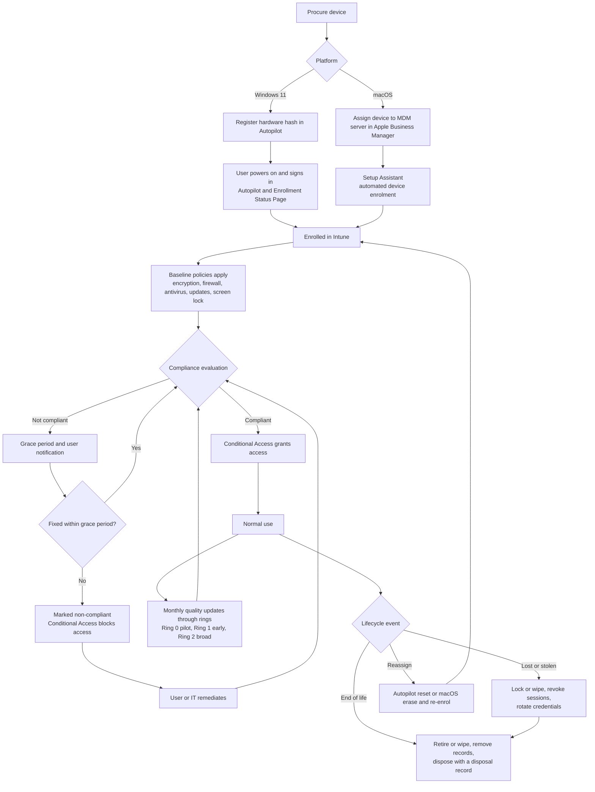

# Device lifecycle

The path a corporate device takes from purchase to disposal, and where the baseline policies,
compliance evaluation and Conditional Access fit in.



A rendered copy is at [images/device-lifecycle.svg](images/device-lifecycle.svg). The source is
[images/device-lifecycle.mmd](images/device-lifecycle.mmd). To regenerate it:

```bash
npx @mermaid-js/mermaid-cli -i docs/images/device-lifecycle.mmd -o docs/images/device-lifecycle.svg
```

## Stage notes

| Stage | Detail | Where to read more |
|---|---|---|
| Register | Windows hardware hashes go to Autopilot. Macs are assigned to the Intune MDM server in Apple Business Manager. | [enrolment-guide.md](enrolment-guide.md) |
| Provision | The device is configured before first use. Policies should land during provisioning so the device is compliant on first sign-in. | [enrolment-guide.md](enrolment-guide.md) |
| Evaluate | Compliance rules run on every check-in. A short grace period avoids blocking someone over a transient state. | [compliance-and-conditional-access.md](compliance-and-conditional-access.md) |
| Patch | Quality updates reach devices ring by ring. A failing update is caught by the pilot ring first. | [rollout-plan.md](rollout-plan.md) |
| Lost or stolen | Lock or wipe the device, revoke the user's sessions, reset credentials, and confirm recovery keys are still escrowed. | [troubleshooting.md](troubleshooting.md) |
| Retire | Wipe, remove the Intune, Autopilot or ABM records as appropriate, and keep a disposal record. | [enrolment-guide.md](enrolment-guide.md) |
